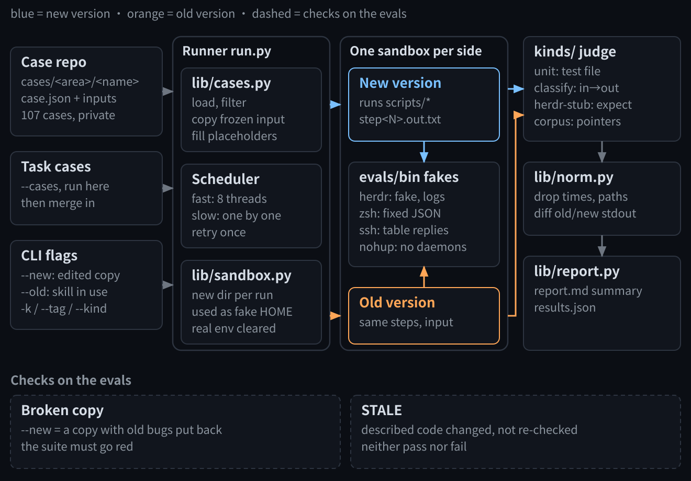
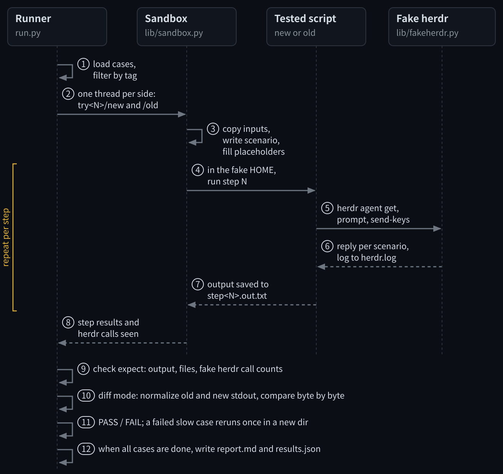

改一个调度 agent 的技能，最怕修好今天的错，又带回上周的错。我把出过的事故冻结成用例，每次改动前让新旧两份技能在假环境里各跑一遍，对不上就不合。

被测的是我的 leader 技能：一个 leader agent 靠它在 herdr 里调度十几个 Claude Code 和 Codex agent，背后是四十多个脚本。调度本身见 [100x Engineering](/blog/100x-engineering/) 和[这张图](/skills/)，评测代码在 [chris-skills](https://github.com/szupzj18/chris-skills/tree/main/skills/agent-patrol/evals)。

## 1. 一次性回放守不住

技能每晚复盘后都会改，改动落地前要拿真实记录回放。以前每次回放都临时搭，跑完就散：两周攒下约 60 项评测，散着 24 份假 herdr。输入直接读在用的快照，几天后就被轮转掉；10 月 25 日一次冒烟测试还写坏了在用的会话目录。

10 月 30 日这些收成了一个执行器和一个用例库。验收只有一条：新旧两份各跑一遍全绿，每项改动至少加一个用例。

## 2. 架构：从用例到报告

[](/img/evals-architecture/architecture.svg)

从左往右是一次运行：

- **输入。** 用例库是本机一个不设 remote 的 git 仓库，一例一个目录：`case.json` 加冻结的输入。冻结的会话片段常带私人内容，所以不进公开仓库。任务自己的新用例先用 `--cases` 跑通，合回时再进用例库；`--new` 指改后的副本，`--old` 指在用的技能。
- **执行器。** `run.py` 按名字、标签、kind 选用例，快道 8 路线程并行，slow 用例放最后串行，失败重跑一次。`lib/sandbox.py` 给每例每版建一个新目录当假 HOME。
- **沙箱。** 新旧两版在各自的目录里跑同样的步骤、同一份输入。PATH 最前面是 `evals/bin`，里面放着 herdr、zsh、ssh、nohup 的**替身**：名字和真命令一样，实际是评测自带的假程序，脚本以为自己在调真的，其实什么也没发出去。
- **判定和报告。** `kinds/` 按四种 kind 判定，`norm.py` 把新旧输出归一后逐字比，`report.py` 汇总成一页报告。

底下一排检验评测本身：把真出过的回归打回一份副本，整套必须变红；用例描述的代码变了、没人重新确认的，标成 STALE。

代码跟着技能走：`evals/` 就在技能目录里，复制技能去改时一起复制，执行器和被测脚本永远是同一版。整个 `evals/` 约 1,500 行，只用 Python 标准库。

## 3. 执行器：一个用例怎么跑完

[](/img/evals-architecture/one-case.svg)

图里 1 到 3 是准备，4 到 7 每一步重复一次，新旧两个线程同时走，8 之后是判定。

### 一个真实用例

10 月 26 日，Claude Code 在一个 agent 的窗格里弹出了 “Teach auto mode” 引导，菜单占住了输入框。转达脚本把菜单当成用户没发出的草稿，不敢动，消息没发出去。修好之后，这次事故冻结成了下面这个用例（脱敏、删减后）：

```json
{
  "kind": "herdr-stub",
  "mode": "diff",
  "what": "发送前弹窗已在：先按 Esc 关掉，再发，回读原文一致",
  "origin": {
    "date": "2026-10-26",
    "note": "Teach auto mode 弹窗的菜单被当成用户草稿，消息没发出去"
  },
  "covers": [
    "scripts/relay.py",
    "scripts/startup_check.py",
    "scripts/input_box.py"
  ],
  "scenario": {
    "mode": "popup",
    "screens": {
      "teach": "@@CASE@@/screens/teach.txt",
      "normal": "@@CASE@@/screens/normal.txt"
    },
    "start_phase": "teach",
    "esc_closes": true,
    "swallow": true
  },
  "steps": [{
    "argv": ["python3", "@@SCRIPTS@@/relay.py", "send", "stub-agent", "-"],
    "stdin": "leader：按清单继续做。",
    "expect": {
      "first_line_regex": "^RELAY-SENT .*原文一致（先按 Esc 关了功能引导弹窗",
      "herdr_calls": {
        "send-keys .*\\besc$": 1,
        "send-keys .*\\benter$": 0,
        "^agent prompt": 1,
        "swallowed": 0
      }
    }
  }]
}
```

`scenario` 描述假 herdr：开局显示当天冻结下来的那块屏幕，按 Esc 回到正常屏幕，弹窗还在时发的消息会被吞掉。`steps` 用这个场景跑一次转达脚本。`expect` 写脚本该做的事：只按一次 Esc，不按 Enter，消息只发一次、没被吞，回读的原文和发出的一致。

`mode: diff` 表示旧版也跑同样的步骤，输出要一致。`@@SCRIPTS@@`、`@@CASE@@` 在跑的时候换成被测那一版的脚本目录和这例的目录。

### 四种 kind

- **herdr-stub**（86 例）：像上面这样，在假 HOME 里对着假 herdr 跑脚本命令，查输出、文件和假 herdr 收到的调用。
- **unit**（14 例）：跑一个冻结的测试文件，按它的输出计数。
- **classify**（6 例）：一张“输入 → 期望”表，逐项过脚本里的某个函数，例如“这块屏幕是不是功能引导弹窗”。
- **corpus**（1 例）：只记 935 个真实会话文件的路径、字节数和 sha256，不拷贝会话；文件不在了就跳过。

### 假 herdr 和其他替身

所有脚本对着同一个假 herdr。除了上面的 `popup`，它还有两种场景：`timeline` 让状态按时间线变化，`codex` 模拟 Codex 的审批、满载和被打断。它不发出任何东西，每次调用在 `herdr.log` 记一行，用例按日志断言副作用。

其他替身：zsh 对账号工具回固定的 JSON，不碰真实账号；ssh 只按用例给的表回答，其余一律失败；nohup 拦住脚本在后台起的守护进程。

### 新旧对比代替标准答案

herdr-stub 里 68 例是 diff 模式。`norm.py` 先抹掉时间、时间戳、两版各自的路径，再逐字比新旧 stdout；用例还可以补正则，或者列出允许不同的行。

这样不用维护标准答案，脚本行为一变就看得见。有意的改动就改用例，在 `origin.note` 写清原因和日期。

### 每例一个干净的环境

每例每版、每次重跑都用一个新目录当假 HOME。指向真实状态的环境变量都清掉（窗格 id、账号配置目录、锁文件等），时区固定成 UTC。10 月 29 日一次复跑复用了假 HOME，上一个任务留下的记录让脚本拒发，出了一次假失败，之后才改成每次都建新目录。

11 月 2 日对在用版本跑整套：107 例，106 例通过，没有失败，用时 14 分钟。剩下 1 例是 STALE。
